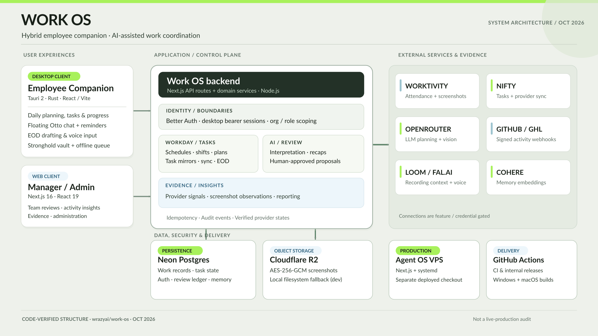
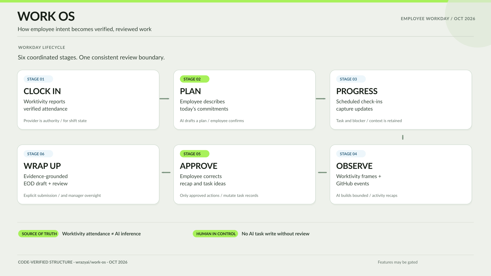

<p align="center">
  
</p>

<h1 align="center">Work OS</h1>

<p align="center">
  <strong>AI-assisted work coordination, from the first clock-in to the final handoff.</strong>
</p>

<p align="center">
  A WrazyAI employee workspace and management platform, with a native desktop companion,
  human-reviewed AI workflows, and evidence-backed reporting.
</p>

<p align="center">
  <a href="#architecture">Architecture</a> ·
  <a href="#employee-workday">Workday flow</a> ·
  <a href="#quick-start">Quick start</a> ·
  <a href="#repository-map">Code map</a> ·
  <a href="#working-on-work-os">Development guide</a>
</p>

> [!NOTE]
> **Internal project.** Access to the web app, integrations, and production data depends on WrazyAI credentials and organization feature flags. The diagrams below document the repository's architecture; they are not a live production-health report.

## What is Work OS?

Work OS brings **daily planning, task execution, attendance context, progress reviews, and end-of-day reporting** into one workspace. Employees use the desktop companion (including the floating **Otto** assistant) or the web workspace; managers use web dashboards to review reports, evidence, and team activity.

It coordinates existing systems rather than replacing them. **Worktivity** is authoritative for attendance, **Nifty** supplies provider-backed tasks, and optional integrations contribute factual activity signals. AI helps interpret and summarize this information, while users retain control of actions that change task records.

## Architecture



[Open the architecture diagram full size](./docs/assets/work-os-architecture.svg)

Work OS follows a **hybrid client–server architecture with a modular backend**:

| Layer | Technology | Purpose |
| --- | --- | --- |
| **Desktop companion** | Tauri 2, Rust, React, Vite | Employee workspace, floating Otto, notifications, local secure state, offline retry queue |
| **Web experience** | Next.js 16, React 19 | Employee workspace, manager/admin dashboards, reviews and insights |
| **Backend** | Next.js Route Handlers, TypeScript domain services | Sessions, plans, tasks, attendance projections, evidence, AI, proposals and EOD reports |
| **Persistence** | Neon PostgreSQL, Better Auth | Organization-scoped work data, identity, task mirrors, audit and approval records |
| **Object storage** | Cloudflare R2 (local adapter for development) | Encrypted, policy-controlled screenshot retention |
| **External services** | Worktivity, Nifty, GitHub, GHL, OpenRouter and optional tools | Provider-attested signals and AI-assisted workflows |

The desktop and web clients share the same server-side business rules. The installed companion connects through a browser-authorized device flow and sends authenticated API requests; its session and offline queue are stored locally through Tauri Stronghold.

### Trust and approval boundaries

- **Attendance comes from Worktivity.** A screenshot observation or an AI prediction never becomes an attendance event.
- **AI drafts; people decide.** Structured task changes enter the proposal/approval flow. Recommendations and recap-generated next steps are not automatically executed.
- **Evidence is attributed.** GitHub events distinguish work **performed** by an employee from CI, reviews or deployments **triggered** by that work. Neither automatically proves a Nifty task is complete.
- **Writes are scoped and replay-safe.** Organization/role checks, idempotency keys, provider readbacks and audit events protect important operations.
- **Screenshot processing is gated.** Consent, feature flags, sensitive-content filtering, retention controls and AES-256-GCM storage encryption apply to retained frames.

## Employee workday



[Open the workday diagram full size](./docs/assets/work-os-workday-flow.svg)

1. **Clock in:** Worktivity-confirmed attendance establishes the shift state.
2. **Plan:** The employee provides their intended work; AI may structure a draft, which they review and confirm.
3. **Progress:** Otto surfaces scheduled check-ins and captures employee updates and blockers.
4. **Observe:** Configured screenshot and GitHub evidence can inform bounded, source-labeled activity recaps.
5. **Approve:** The employee confirms or corrects recaps and explicitly decides on proposed task changes.
6. **Wrap up:** An evidence-grounded EOD draft is reviewed and submitted for management visibility.

The default check-in cadence is 60 minutes, with an initial follow-up normally 75 minutes after plan confirmation or clock-in. These intervals can be configured within server-defined bounds.

## Repository map

```text
work-os/
├── desktop/work-os-companion/
│   ├── src/                    # React UI, Otto, client API and local state
│   ├── src-tauri/              # Rust host, native commands and updater
│   └── README.md               # Desktop development and release handbook
├── src/
│   ├── app/work-os/            # Employee and manager/admin web routes
│   ├── app/api/work-os/        # Authenticated HTTP endpoints and webhooks
│   ├── modules/work-os/        # Web UI and shared workday logic
│   └── lib/
│       ├── work-os-*.ts        # Task, workday, proposal and evidence services
│       ├── ai*.ts              # Planning, interpretation, EOD and voice AI
│       └── db/                 # PostgreSQL query and object-storage adapters
├── neon/migrations/            # Neon-era schema changes
├── supabase/migrations/        # Historical and continuing SQL migrations
├── test/                       # Work OS server and integration tests
├── docs/                       # Migration, pilot and verification notes
├── design.md                   # Canonical product design blueprint
└── AGENTS.md                   # Repository workflow and safety constraints
```

> [!IMPORTANT]
> Paths under `src/lib/supabase/` are **Postgres compatibility adapters**, not evidence that Supabase Auth or Storage is still the active production dependency. Consult [the Neon migration notes](./docs/NEON-MIGRATION-PLAN.md) before changing the persistence layer.

## Quick start

### Prerequisites

- **Node.js 22** and npm (the version used by CI).
- Access to the WrazyAI repository and a development environment/configuration from the maintainers.
- For the **native companion**: a supported Windows or macOS host, the Rust toolchain, and [Tauri 2 system prerequisites](https://v2.tauri.app/start/prerequisites/).
- An authorized account and configured backend are needed to exercise the complete login, task, attendance or AI flows.

### Web application and API

```bash
git clone git@github.com:WrazyAI/work-os.git
cd work-os
npm ci

# Obtain approved local settings/secrets from a maintainer.
# Store them in .env.local; never commit credentials.
npm run dev
```

The local Next.js application starts at **http://localhost:3000**. API routes that depend on Neon, provider credentials or feature flags may remain unavailable until those services are configured.

### Desktop companion

From the repository root:

```bash
cd desktop/work-os-companion
npm ci

# Native desktop app (Windows development)
npm run tauri:dev

# On a supported macOS host:
# npm run tauri:dev:macos
```

To point the companion at an approved non-production backend, configure `VITE_WORK_OS_API_URL` before starting it. Device authorization uses a secure browser flow, and packaged sessions require HTTPS; starting the UI alone does not provision a usable account. See the [companion handbook](./desktop/work-os-companion/README.md) for platform-specific builds, installers, update signing and troubleshooting.

### Service configuration

Keep secrets **server-side**, never in desktop bundles or `NEXT_PUBLIC_*` variables.

| Configuration | Used for |
| --- | --- |
| `DATABASE_URL`, `BETTER_AUTH_SECRET` | PostgreSQL and authenticated web sessions |
| `OPENROUTER_API_KEY` | Every AI surface: planning, updates, activity interpretation, screenshot perception, recaps and EOD drafts |
| `WORKTIVITY_API_KEY` | Provider-confirmed attendance and screenshot ingestion |
| Nifty OAuth credentials | Task provider authorization and synchronization |
| `OBJECT_STORAGE_DRIVER`, `R2_*` | Screenshot object storage (R2 in production; local adapter for development) |
| `FAL_API_KEY`, `COHERE_API_KEY` | Optional voice transcription and memory embeddings |
| GitHub/GHL webhook secrets | Signed evidence ingestion when those integrations are enabled |

The specific requirements depend on the feature being exercised. Do not run historical migrations against an established database; follow the explicit additive migration process described in [AGENTS.md](./AGENTS.md).

### AI models and provider routing

`src/lib/work-os-ai-model.ts` is the single place that decides which model answers each AI surface and how OpenRouter is asked to route it. Two models are in play:

- **DeepSeek V4.1 Flash** (`deepseek/deepseek-v4.1-flash-1017`) answers every synthesis surface — recaps, summaries, extraction and proposals. Its requests are pinned to the `relace` provider with fallbacks disabled, so a payload is never handed to a different vendor than the deployment asked for.
- **gpt-6-luna** (`openai/gpt-6-luna`) answers per-frame screenshot perception, where the job is to describe what is visibly on screen and nothing else.

| Variable | Used for |
| --- | --- |
| `WORK_OS_INTERPRET_MODEL` | Deployment-wide override for the synthesis surfaces |
| `WORK_OS_SCREENSHOT_MODEL` | Screenshot perception only |
| `WORK_OS_ACTIVITY_INTERVAL_MODEL`, `WORK_OS_PLAN_MODEL`, `WORK_OS_NEXT_STEPS_MODEL`, `WORK_OS_AI_MODEL` | Individual synthesis surfaces |
| `WORK_OS_AI_PROVIDER_ONLY` | Replaces the pinned provider list for pinned models |
| `WORK_OS_AI_ALLOW_FALLBACKS` | Re-enables fallback providers for pinned models |
| `WORK_OS_AI_REASONING_EFFORT` | Reasoning effort for the synthesis model (`minimal`, `low`, `medium`, `high`, or `none` to turn reasoning off) |

The synthesis model reasons before it answers, and those reasoning tokens come out of the same completion budget as the answer. The effort is bounded so a reasoning pass cannot spend the whole budget and leave a truncated answer behind.

### Prompt caching and usage

The provider caches a stable request prefix automatically, so each chat prompt is ordered with the reusable blocks first — the rules, then the task list, then the available templates — and the employee's own words, the day state, the memory block and the recent conversation last. With a few hundred tasks that prefix is over ninety percent of the prompt, so a warm turn serves most of its input from cache. `npm run work-os:measure-prompt-cache` measures the hit rate against the real provider.

Every model call reports its token accounting as one structured journal line:

```
[ai-usage] {"surface":"interpret","promptTokens":7164,"cachedPromptTokens":6656,"completionTokens":720,"cacheHitPercent":93}
```

Read it back with `journalctl --user -u agentos-web | grep '\[ai-usage\]'`.

## Validate your changes

From the repository root:

```bash
npm run lint
npm run work-os:typecheck
npm run work-os:test
```

For desktop changes:

```bash
cd desktop/work-os-companion
npm test
npm run build
```

GitHub Actions covers web checks, companion checks and internal release-policy guards. UI changes should also be verified in the rendered application, including loading, error, offline and keyboard states.

## Working on Work OS

- **Read [AGENTS.md](./AGENTS.md) before modifying behavior.** It documents worktree isolation, task tracking, testing, safety invariants and cross-repository reconciliation.
- **Follow [design.md](./design.md) for UI work.** It defines the shared desktop/web visual language and interaction contracts.
- **Keep product and deployment separate.** This repository is authoritative for Work OS source and the companion. The production web/runner services operate from the separate **Agent OS** checkout on the VPS. Updating `main` here does **not**, by itself, verify or perform a production deployment.
- **Keep provider credentials out of source control.** Respect organization boundaries, employee consent, idempotency and provider-verified outcomes.
- **For desktop releases**, read the [release handbook](./desktop/work-os-companion/README.md) and [changelog](./desktop/work-os-companion/CHANGELOG.md). Internal Windows installers are unsigned; update signatures are not equivalent to OS code-signing.

### Further reading

[Companion development and releases](./desktop/work-os-companion/README.md) · [Product design](./design.md) · [Neon migration](./docs/NEON-MIGRATION-PLAN.md) · [Work OS pilot](./docs/work-os-pilot.md) · [Engineering verification](./docs/VERIFICATION-REPORT.md)

---

<p align="center"><sub>Work OS · WrazyAI · Internal engineering documentation</sub></p>
